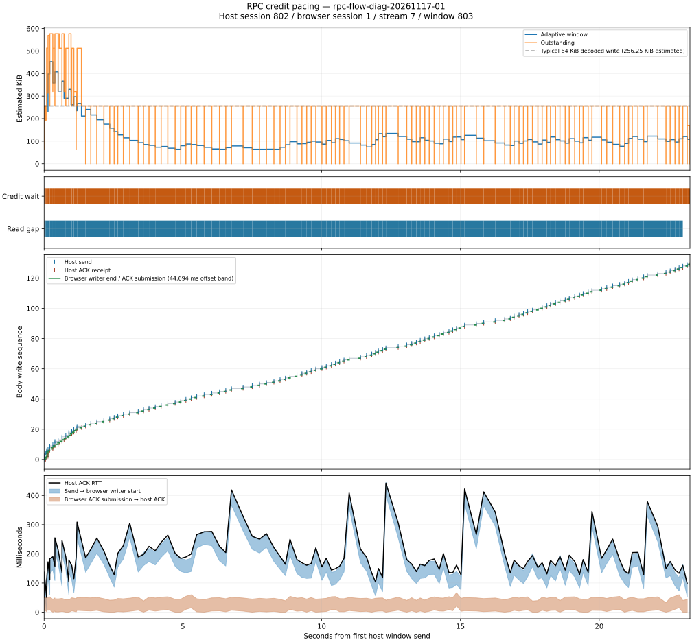

# RPC credit-window startup analysis

The immediate limitation is demand gated by a small adaptive RPC credit window, coupled to substantial send-to-browser delivery latency. The browser settles writes promptly; the host releases credit promptly after ACK receipt. The trace does not measure spare link capacity or distinguish transport/proxy queuing from browser message delivery scheduling. More credit may hide feedback latency, or may only increase queues. A bounded A/B experiment is justified; a production tuning claim is premature.

## Evidence and identity

Capture `rpc-flow-diag-20261117-01`, revision `9a18e07`, navigation 2026-11-17 12:00:11.879419 UTC. Connection `09def869-d916-40b2-b1a9-4e4d53cc9f12`, request `87d9beac-d1b4-472b-8e32-0fadf7f64835`, host session **802**, browser session **1**, stream **7**, window **803**, port `message_port_ipc_bridge_1`. These IDs are local to this recording, not production selectors.

All 130 host sends/tokens/ACKs join to browser writer operations, with matching decoded byte counts in order and final close total **7,957,011 B**. Operation slots run from 8 to 147 with intervening unrelated operations; they must not be inferred from chunk index. There are 122 complete, successful, nonoverlapping credit waits, no drops or missing diagnostic sequences. Five failed writes on other streams explain their absent successful ACKs; bootstrap has none. The upstream diagnostic context is `correlated:false`: identity comes from the actual diagnostic response header and bridge IDs, not an invented original fetch UUID. The existing Chromium profile and normal cache were reused; both major JS assets revalidated 304. Physical WAN/direct-versus-relay classification remains unknown.

The host's supplied restoration records confirm both flags disabled and normal health restored. No service change was made during analysis. Input attachments and raw browser artifacts remain outside Git; derived metadata is committed. [Source hashes and computed results](correlation-summary.json) identify the analysis inputs.

## Quantitative accounting

| Measurement | Result | Interpretation |
| --- | ---: | --- |
| First host window send → final host ACK | 23.268229 s | Reference transfer/feedback span, not navigation duration |
| 122 credit waits, reported duration sum | **23.173119 s** | Median 178.484 ms; p95 345.406; max 441.820 |
| Credit interval union, observed hooks | 23.173075 s | 0.043769 ms less than duration sum due to hook timestamp placement |
| 130 read-demand gaps, including EOF demand | **22.990543 s** | Do not add to credit waits |
| Read gaps intersecting credit waits | **22.896939 s (99.592859%)** | Actual interval intersection, not correlation of totals |
| Read gaps outside credit waits | **93.603984 ms** | Residual demand/adapter/scheduling time, not proven CPU time |
| Credit intervals outside observed read gaps | 276.136136 ms | Different pipeline boundaries and tail; not unexplained reader delay |
| 131 underlying read promise waits, including EOF | 19.879681 ms | Demand-driven availability, not raw ingress measurements |
| Browser writer waits, all 130 writes | **24.900 ms** total | Median 0.200 ms, max 2.800 ms |
| Writer settlement → ACK submission | 2.000 ms total | Median 0; max 0.100 ms |
| Host ACK observation → credit release | 0.750153 ms total | Median 0.005941; max 0.014299 ms |
| Host ACK RTT | 50.424–441.825 ms | Median 180.254; p95 345.407 ms |
| Transfer-period host event-loop sample maximum | 22.643 ms | 20-ms sampling resolution; not an exclusive per-request delay |

For each credit end, the join selects the immediately preceding window-803 ACK that leaves outstanding bytes below the current window. All 122 joins release within 0.015 ms. [Credit release rows](credit-releases.csv) name the releasing operation/token; [write rows](correlated-writes.csv) provide its browser writer/ACK timestamps and host receipt. This is a transport/credit identity join, not a guess based on neighboring browser timestamps.

The 23.173 seconds comprise repeated waits for sufficient remote writer ACK credit. They are not 23 seconds of browser computation or host CPU. The RTTs sum to 25.268 seconds but overlap each other and the waits; their sum is not another elapsed-time component. Credit is unresolved for approximately 99.59% of the first-send→last-ACK span. Reader promises resolve quickly once called; buffering/decompression below this demand gate still prevents claims about when the entire upstream body was originally produced.

The 93.604-ms read-gap residual is the remaining time outside measured credit blocking. Event-loop samples cannot partition it exactly. A 22.643-ms loop maximum at 20-ms resolution is consistent with ordinary timer scheduling and cannot be summed across samples or subtracted from that residual. The 282.329-ms whole-capture maximum occurs after bootstrap EOF and cannot explain the body pacing.

## Clock bounds and timeline

For each probe, **host minus browser ∈ [H0−B, H1−B]**. Thirteen host samples match browser probes; two additional browser replies have no host sample and contribute no bounds. The nearest sample's independent bounds are retained on every write row, even when broad. Across the five probes sent between first body send and last ACK, bounds have a compatible constant-offset intersection **[249769.334215, 249814.027889] ms**, width **44.693674 ms**. The best transfer-period probe has that same interval; nearest-probe RTTs can be much broader. This intersection assumes effectively constant relative clock offset during the approximately 23-second body transfer.

Across all 13 samples the compatible intersection is [249772.353774, 249810.582283] ms, width 38.228509 ms. The best individual whole-run probe has width 39.166594 ms, after transfer; it is not substituted for the transfer probe. Samples are compatible with a constant offset, but this does not establish a drift bound. A hypothetical 100-ppm relative rate error over 23.3 seconds adds about 2.3 ms; this is sensitivity, not measured drift. No wall-clock synchronization or symmetric network latency is assumed.

Under the transfer constant-offset model:

| Cross-side stage | Median lower–upper bound | Largest per-operation upper bound |
| --- | ---: | ---: |
| Host send → browser writer start | **133.160–177.853 ms** | 445.202 ms |
| Browser ACK submission → host ACK receipt | **3.530–48.223 ms** | 66.493 ms |

Negative causal lower bounds are clipped to zero. Some conservative outbound upper bounds exceed a token's RTT; intersecting with causal token ordering could narrow them. These are component bounds, not independent additive measurements. Using only nearest probes, median return bounds widen to **0–99.234 ms**. The directional inference is consequently strongest under the transfer-period stable-offset model. Send→writer includes encoding, transport/proxy queuing, complete-message receipt, and browser dispatch; it is not pure one-way packet flight. ACK return includes submission/transport/host dispatch, not just the reverse network path.

| Milestone | Local clock / navigation-relative time |
| --- | --- |
| Upstream request start | Host 261243.088437 ms |
| Upstream headers | Host 261646.550656 ms |
| First decoded read | Host 261649.069567 ms |
| First window send | Host 261649.690232 ms |
| Browser headers receipt | Browser +11.881100 s |
| Last decoded data read | Host 284526.331874 ms |
| EOF read completion | Host 284660.253608 ms |
| Browser explicit stream close | Browser +35.145800 s |
| Last token ACK | Host 284917.918896 ms |
| Evaluations published | +35.466731 s from CDP navigation |
| Routes mounted | +51.826577 s from CDP navigation |

Browser `performance.timeOrigin` is about 0.919 ms before the first CDP navigation request; the table labels the two origins rather than conflating them. Evaluation/mount milestones come from outbound IPC metadata because console milestone hooks were absent. They are associated with the latest bootstrap, not exact JSON parsing spans. Evaluation publication→mount is another **16.359846 s**; tuning body flight cannot be assumed to remove this startup dependency.



The third panel joins each send to its ACK with the browser settlement/submission band between them. The lower panel shows bounded directional intervals, not independently measured transport components.

## Adaptive algorithm and byte units

The inspected packaged host implementation (`st.onSend/onAck`, `ct` writable adapter) uses an initial **262,144**, minimum **65,536**, and maximum **1,073,741,824** estimator-byte window. It adds an entire atomic write before testing `bytesInFlight >= window`, so occupancy can exceed the window. ACK success means the remote `writer.write()` settled; it does not require application initialization or route mounting.

The ACK algorithm estimates delivery rate as `(delivered − deliveredAtSend) / (ackTime − deliveredTimeAtSend)` (with a first-ACK bootstrap case). It targets `rate × minRTT × gain`, where gain is 2 in startup, 1.25 afterward; caps growth relative to the token's send-time window; and limits per-token decrease to 90% of that send-time window when full. It exits startup after three rounds without >25% window growth. This is an ACK-derived delivery-rate controller, not TCP's byte accounting.

Measured behavior:

- Window peaks at **463,802.108** estimator bytes, then shrinks; final value **112,515.787**.
- Startup first becomes false at +0.719 s, ACK operation 25. Later sends can still carry tokens made during startup.
- The floor is reached at **five ACKs**, at +4.721, +6.318, +7.498, +7.759 and +8.279 s. Time exactly at the floor is **1.162078 s (4.99%)**; it is repeatedly reached, not continuously pinned.
- Time at or below 128 KiB is **20.022068 s (86.05%)**. Time below a typical write's estimator size is **22.093715 s (94.95%)**; 114/130 ACK-state windows are smaller than that write.
- 117 writes each consume **262,404 estimator bytes** for **65,536 decoded bytes**. Eight sends do not immediately block; 122 do. After the initial pipeline burst the common pattern is one write, await ACK, next write.

A one-write stream with an approximately 180-ms RTT and 50.4-ms minimum RTT estimates about `262404 / 180 × 50.4 × 1.25 ≈ 91,840` estimator bytes—less than one atomic write. Even a 2× startup gain need not restore two-write flight in that regime. Once the source is credit-limited, the observed delivery rate is itself limited by credit. This can reinforce a small target; without probing a larger bounded flight, the algorithm cannot distinguish spare path bandwidth from its own application-limited rate. Lack of a recent peak-rate filter, a write-granularity floor, and RTT aging are concerns, not separately proven causes. The 50.4-ms minimum is lower than the median round trip, but not proof that it is stale or wrong. The algorithm preserves bounded demand and responds to measured timing, yet its window is poorly matched to these atomic writes if the path has headroom.

**7,957,011 decoded body bytes** are the response bytes after upstream HTTP decompression. **31,861,839 estimator bytes** (4.00425× the decoded total) include RPC value/string/base64 accounting and overhead; they are neither heap occupancy nor network bytes. **590,604** is the maximum observed estimated flight, not a decoded buffer measurement. Upstream Brotli compression and downstream WebSocket permessage-deflate are separate compression layers. CDP WebSocket payloadData is already decompressed; neither it nor the estimator measures compressed WebSocket/TLS/TCP wire bytes. Actual compressed frame byte counts for this run were not captured. Do not derive WAN utilization or memory requirements by treating estimator bytes as wire or resident bytes.

## Optimization assessment

| Candidate | Expected throughput impact | Memory, cancellation and backpressure assessment |
| --- | --- | --- |
| Raise initial window only | Shorter initial burst if useful; steady adaptation still collapses | More startup flight across streams; no evidence this alone addresses 95% of transfer |
| Raise minimum to a bounded two-write floor | Direct test of the observed one-write limit; ideal fixed-latency ceiling near 2×, not a prediction | One extra typical 64-KiB decoded write in flight; representations add heap cost. Cancellation can leave extra flight; ACK-after-settlement and rejection paths must remain intact |
| Improve adaptive growth with a recent peak-rate filter / application-limited detection | Could preserve useful bandwidth estimates and reduce collapse without a permanent floor | More algorithmic state/edge cases and possible queue overshoot; needs controlled rate/RTT simulation and a hard flight budget. No filter horizon/gain is justified by this one run |
| Independently pipeline additional bounded writes | Similar overlap benefit if this is feedback-limited | Adds producer/cancel/EOF ordering complexity; use existing credit path first instead of bypassing its await |
| Reduce unnecessary ACK latency | Browser submission ≤0.1 ms and host release ≤0.015 ms leave negligible measured local savings | Do not ACK before writer settlement. Reverse-path delay is real but unlocalized; inspect transport flush/queuing before proposing a change, and preserve ACK failure semantics |
| Improve browser consumption | At most 24.9 ms directly observed write-wait budget here | No measured consumer stall justifies a change. Message dispatch scheduling is included in outbound latency and is a different boundary |

**Minimal proposal:** test a host-only minimum of **524,288 estimator bytes (512 KiB)**, leaving initial window and ACK/adaptation behavior otherwise unchanged. Two common writes sum to 524,808 estimated bytes; because atomic sends overshoot before the existing test, this floor admits two before blocking. The current controller admits essentially one. This is a deliberately small capacity experiment supported by the occupancy trace, not an assumption that bandwidth doubles. Keep the default minimum at 65,536 outside the isolated candidate. [Separate code-level change and acceptance gates](patch-proposal.md).

The larger floor does not make RPC memory unbounded: for this stream the minimum-regime overshoot is less than `floor + largest atomic write`, conservatively **844,835 estimator bytes** using the observed 320,547-byte maximum. That is not a heap cap, nor a global maximum if adaptation grows. Baseline peak flight already reaches 590,604 estimator bytes. With typical writes, added steady flight is about one decoded 64-KiB chunk; multiple encoded/decoded/string copies and concurrent streams require measured process/renderer memory. A global production floor would also affect unrelated streams and is not approved by this analysis.

If the path is bandwidth-limited, this may increase RTT/queues without improving body time. If feedback-limited, overlapping another write may hide a meaningful portion of each round trip. ACK return alone is not the dominant observed stage. The most likely limitation is the interaction of delivery latency and the controller's sub-chunk credit target; the trace cannot rank all underlying network/proxy/scheduler causes or establish an optimal bandwidth-delay product.

## Controlled A/B plan

1. Prepare immutable isolated A/B candidates from the same revision, diagnostic hooks, compression sidecars, and settings. A retains all constants. B changes only the host minimum to 512 KiB. Record actual loaded hashes. Do not rebuild the live deployment, alter ACKs/timeouts/chunking/cache, or use diagnostic IDs as runtime selectors. Starting either candidate on the service requires separate deployment authorization; none is given here.
2. First run existing extracted-core body/order/EOF, cancellation, failed-write/rejected-credit and real Chromium WebSocket/MessagePort checks against the candidate. Add a meaningful slow/stopped-consumer test: ACKs must remain pending until actual writer settlement, in-flight work must plateau, cancellation must reject the credit waiter and stop production. Verify bounded overshoot with mixed small/64-KiB/large writes. Test unrelated concurrent RPC streams; a host-wide floor has a wider blast radius than this bootstrap.
3. Conduct at least six paired warm measurements with balanced AB/BA order on the same CFFV5 path, Chromium profile, account, viewport and normal cache. One measured reload at a time, after both sides are ready. Record body size/chunk distribution, CPU/RSS/heap, RTT probes and tailnet path classification if available; do not compare a fresh cold profile to a warm one. If bootstrap bodies differ, report byte-normalized throughput and paired body sizes rather than treating unequal totals as identical workloads.
4. Primary endpoint: first decoded body read→last browser body/close, plus credit/read-gap overlap and decoded throughput. Secondary: full navigation→evaluations/mount, ACK p50/p95, window/flight maxima, host event-loop samples, socket bufferedAmount, browser receipt→writer start, and both process memory series. Preserve calibration uncertainty. Do not promise that the separate 16.36-s evaluation→mount interval shrinks.
5. Trial resource guard: one active captured bootstrap; stop B on >1 MiB estimated flight on the selected stream (account for hook observation order), >16 MiB sustained host **or renderer** RSS increase over paired A, monotonic queue growth, or materially worse p95 ACK RTT (>25%). The flight threshold is an experiment abort condition, not a new data-path cap and not a heap guarantee. Measure concurrent-stream cost separately before any rollout. If adaptation itself exceeds the budget, stop rather than silently adding another tuning variable.
6. Verify exact ordered bytes and EOF for synthetic fixtures, no duplicated/lost bytes, equal per-run decoded read/write/close totals, all successful writer ACKs, prompt failure propagation, no unhandled rejection, and successful route/editor readiness. Cancel at early/mid/late transfer and with a stalled consumer. Require source production to stop, credit promises to settle, references to be released and memory to return near baseline after normal GC settling; do not require zero already-queued network bytes after cancellation.
7. Proceed only if paired body time improves consistently (predeclare ≥15% median improvement as a useful trial threshold), with no correctness regression, queue growth, memory-budget breach or latency tradeoff beyond the guard. Otherwise reject the floor change; investigate outbound message timing and/or simulate a rate-filter design. Remove diagnostics through the normal approved lifecycle after any future test. Current host is already restored.

## Reproduction and historical scope

Run the analysis with Python plus matplotlib, passing the extracted sanitized host directory and preserved browser metadata directory:

```sh
python docs/rpc-flow-diag-20261117-01/analyze.py \
  /path/to/rpc-flow-diag-20261117-01-host \
  /path/to/rpc-flow-diag-20261117-01 \
  docs/rpc-flow-diag-20261117-01
```

The script verifies all 130 writer/byte/ACK joins and all 122 ACK-to-release joins; it outputs metadata CSV/JSON and the SVG chart. Read-gap intersection uses the actual `upstream-read-gap` span, not the slightly later read-start logging hook. Timestamps are not precise enough to interpret microsecond differences as transport work.

The historical capture's **19.160951 s** of inter-read time had 135 body writes and no credit instrumentation. This run's **22.896939-s** measured credit/read-gap overlap strongly corroborates the suspected feedback mechanism. It does **not** prove a numeric allocation of the old 19.161 seconds; no defensible exact percentage or saved-time forecast can be backfilled. The new run answers where demand waits now, with a 93.604-ms residual, and motivates the controlled capacity test.
